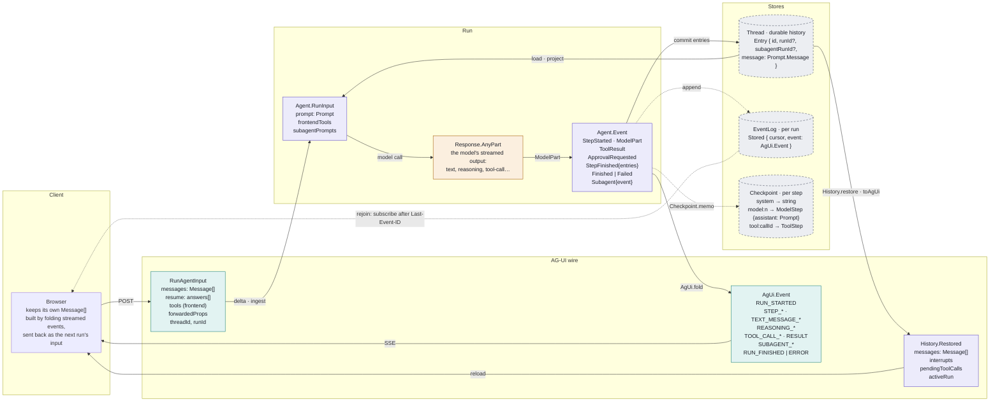

# One conversation, four shapes

_effect-agent-harness · message model_

A turn of conversation exists in four shapes: a streamed event, a model part, a stored entry and a client message. Each shape belongs to one boundary, and the library converts between them at fixed points. This page maps every type: what it contains, which workflows use it, and why it can't be merged with its neighbour.

Every type has an owner, shown as a tag throughout:

| Tag         | Owner                                         |
| ----------- | --------------------------------------------- |
| **[wire]**  | AG-UI wire type (`effect/ai` `AgUiSchema`)    |
| **[model]** | Model type (`effect/ai` `Prompt`, `Response`) |
| **[own]**   | Harness-owned type                            |
| **[store]** | Store (a pluggable service)                   |

## The map

From left to right: the browser, what crosses the wire, what the run computes with, and what the server keeps. Each arrow is labelled with the function that does the conversion. Under the client history the stores are skipped: the client's `messages` become entries in memory and nothing is stored.

## Anatomy of a run

This is one run on a new thread under the server history. The user asks about the weather. Step 1 reasons and calls a backend tool, `get_weather`. Step 2 answers.

Each row is one moment, with time running down the table. A cell names what that moment creates and the owner of its type. The ids are made up for the example:

| Thing         | Id         |
| ------------- | ---------- |
| Thread        | `t`        |
| Run           | `r1`       |
| User message  | `u1`       |
| Step messages | `m1`, `m2` |
| Tool call     | `c1`       |
| Tool result   | `t1`       |

The "AG-UI event" column is what the client receives. Detached and workflow runners also append each of those events to the run's `EventLog` with an increasing cursor, which is how a client reconnects. An attached runner streams them straight to the response. A system prompt given as an effect adds a `system` memo before step 1.

**Open:** the runner starts the run and calls `History.beginAttempt`.

| Moment      | Client                                                                                            | AG-UI event                                       | Run (`Agent.Event`)                                                                         | Thread (`Entry`)                                                                                                                                                                                          | Checkpoint (memo name → value)                                                                                  |
| ----------- | ------------------------------------------------------------------------------------------------- | ------------------------------------------------- | ------------------------------------------------------------------------------------------- | --------------------------------------------------------------------------------------------------------------------------------------------------------------------------------------------------------- | --------------------------------------------------------------------------------------------------------------- |
| request     | [wire] `RunAgentInput`: messages `[u1 user "Weather in Philly?"]`, no tools, thread `t`, run `r1` | [wire] `RUN_STARTED`, sent first, before any work |                                                                                             |                                                                                                                                                                                                           |                                                                                                                 |
| fingerprint |                                                                                                   |                                                   |                                                                                             |                                                                                                                                                                                                           | [store] `input → string`: the encoded input. Reusing `r1` with a different input fails with `RunInputMismatch`. |
| history     |                                                                                                   |                                                   |                                                                                             | [store] `claim(t, r1)`, then `load → []`. `delta` finds the client's new messages, `[u1]`, and `ingest` turns them into entries. [own] `commit [u1]`: `u1` is a user entry with a text part and run `r1`. |                                                                                                                 |
| prompt      |                                                                                                   |                                                   | [own] `Agent.RunInput`: the prompt comes from the memo. `Agent.run` adds the system prompt. |                                                                                                                                                                                                           | [store] `prompt → Prompt` (`project(entries)`: `[user]`). [store] `subagent-prompts → {}`.                      |

**Step 1:** the model streams, then its tool calls run.

| Moment     | Client                           | AG-UI event                                                                                                                 | Run (`Agent.Event`)                                                                                                                 | Thread (`Entry`)                                                                                                                              | Checkpoint (memo name → value)                                                                                                                   |
| ---------- | -------------------------------- | --------------------------------------------------------------------------------------------------------------------------- | ----------------------------------------------------------------------------------------------------------------------------------- | --------------------------------------------------------------------------------------------------------------------------------------------- | ------------------------------------------------------------------------------------------------------------------------------------------------ |
| step start |                                  | [wire] `STEP_STARTED`                                                                                                       | [own] `StepStarted`: step 1, with a newly minted message id `m1`                                                                    |                                                                                                                                               |                                                                                                                                                  |
| reasoning  | shows the thinking as it arrives | [wire] `REASONING_START`, `REASONING_MESSAGE_START`, `CONTENT` × n, `END`, `REASONING_END`. Id `m1:reasoning:0`. Text only. | [own] `ModelPart` × n, each carrying [model] reasoning parts. The signature stays in the part's options and never reaches the wire. |                                                                                                                                               |                                                                                                                                                  |
| tool call  |                                  | [wire] `TOOL_CALL_START c1` (`parentMessageId m1`), `TOOL_CALL_ARGS` × n                                                    | [own] `ModelPart` × n, each carrying [model] tool-call parts                                                                        |                                                                                                                                               |                                                                                                                                                  |
| model done |                                  |                                                                                                                             |                                                                                                                                     |                                                                                                                                               | [store] `model:1 → ModelStep`: `{messageId m1, assistant: Prompt, toolCalls [c1], finishReason "tool-calls"}`. Stored once the stream completes. |
| tool runs  |                                  |                                                                                                                             | The `get_weather` handler runs inside its memo.                                                                                     |                                                                                                                                               | [store] `tool:c1 → ToolStep`: `Result {messageId t1, encodedResult, isFailure false}`                                                            |
| results    |                                  | [wire] `TOOL_CALL_END c1`, then `TOOL_CALL_RESULT` (message id `t1`, content is the result as JSON)                         | [own] `ToolResult`, emitted once every call in the step has finished                                                                |                                                                                                                                               |                                                                                                                                                  |
| step end   |                                  | [wire] `STEP_FINISHED`, sent only after the commit to its right                                                             | [own] `StepFinished`: entries `[m1, t1]`                                                                                            | [own] `commit [m1, t1]`. `m1` is an assistant entry with a reasoning part and a tool-call part. `t1` is a tool entry with a tool-result part. |                                                                                                                                                  |

**Step 2:** the model answers in text. There are no tool calls, so the loop stops.

| Moment     | Client                          | AG-UI event                                                                    | Run (`Agent.Event`)                                     | Thread (`Entry`)                                                 | Checkpoint (memo name → value)                                                     |
| ---------- | ------------------------------- | ------------------------------------------------------------------------------ | ------------------------------------------------------- | ---------------------------------------------------------------- | ---------------------------------------------------------------------------------- |
| step start |                                 | [wire] `STEP_STARTED`                                                          | [own] `StepStarted`: step 2, message id `m2`            |                                                                  |                                                                                    |
| text       | shows the tokens as they arrive | [wire] `TEXT_MESSAGE_START m2`, `TEXT_MESSAGE_CONTENT` × n, `TEXT_MESSAGE_END` | [own] `ModelPart` × n, each carrying [model] text parts |                                                                  |                                                                                    |
| model done |                                 |                                                                                |                                                         |                                                                  | [store] `model:2 → ModelStep`: `{messageId m2, toolCalls [], finishReason "stop"}` |
| step end   |                                 | [wire] `STEP_FINISHED`                                                         | [own] `StepFinished`: entries `[m2]`                    | [own] `commit [m2]`: `m2` is an assistant entry with a text part |                                                                                    |

**Close:** `attempt.end` runs before the terminal event is sent.

| Moment   | Client                                              | AG-UI event                                                                                  | Run (`Agent.Event`)                                        | Thread (`Entry`)                                                                                    | Checkpoint |
| -------- | --------------------------------------------------- | -------------------------------------------------------------------------------------------- | ---------------------------------------------------------- | --------------------------------------------------------------------------------------------------- | ---------- |
| outcome  |                                                     |                                                                                              | [own] `Finished`: outcome `Success`, no pending tool calls | [store] `runEnded(t, r1, Success)`, the store's hook for compaction. Then [store] `release(t, r1)`. |            |
| terminal | The stream ends. The client now holds its messages. | [wire] `RUN_FINISHED`, sent after the release so the client's next run finds the thread free |                                                            |                                                                                                     |            |

### After the run

**The Thread** holds four entries, all with run `r1`. This is what the next run loads and projects:

1. `u1`: user, with a text part
2. `m1`: assistant, with a reasoning part (and its signature) and a tool-call part for `c1`
3. `t1`: tool, with the tool-result part for `c1`
4. `m2`: assistant, with a text part

**The client** holds five AG-UI messages, folded from the events. `History.restore` returns the same list:

1. `u1`: user
2. `m1:reasoning:0`: reasoning
3. `m1`: assistant, with tool call `c1`
4. `t1`: tool, answering `c1`
5. `m2`: assistant, with content

**On the next run,** the client sends all five back, plus a new user message `u2`. `delta` matches `u1`, `m1`, `t1` and `m2` by id, ignores the reasoning row, and commits only `u2`.

### Variations

**If `get_weather` needed approval:**

- `tool:c1` stores `ApprovalRequested` instead of a result, and the run emits `ApprovalRequested`.
- Step 1 commits only `m1`, which now has a tool-approval-request part. There is no `t1`.
- The run ends `Interrupted`: `runEnded(Interrupted)` is called, then `RUN_FINISHED` is sent with an `Interrupt`.
- In the next run, the `resume` answer becomes a tool-approval-response entry, and step 0 runs or denies the call.

**If `get_weather` were a frontend tool:**

- There is no memo and no `TOOL_CALL_RESULT`. `TOOL_CALL_START` and `TOOL_CALL_ARGS` still stream.
- `m1` is committed with the call marked as a frontend call. There is no `t1` and no step 2.
- `RUN_FINISHED` lists `c1` in `pendingToolCallIds`.
- The client runs the tool and sends a tool message, which the next run commits as `t1`.

**If the process died after `model:1` was stored:**

- A workflow runner, or a restarted detached run, executes `r1` again.
- `input`, `prompt` and `model:1` come back from the store. `StepStarted` has `replayed: true`, and no `ModelPart`s are emitted.
- `closeOpen` closes the spans the dead attempt left open in the log, and `fold` drops replayed events.
- `tool:c1` was never stored, so the handler runs now, and the run carries on live from there.

## How they nest

Two nestings carry the design:

- A stored `Entry` wraps an `effect/ai` message without changing it.
- An `Agent.Event` carries both a model part, for the wire, and the entries a step produced, for the store.

### `Messages.Entry` [own]

Stored in the `Thread`, one per message.

- `id`: the AG-UI message id the client sees
- `runId?`: the run whose commit appended it
- `subagentRunId?`: the subagent that owns it
- `message: Prompt.Message` [model]. Every part carries provider `options`. By role:
  - `system`: text (compaction summaries, and client instructions when allowed)
  - `user`: `text`, `file`
  - `assistant`: `text`, `reasoning`, `file`, `tool-call`, `tool-result`, `tool-approval-request`
  - `tool`: `tool-result`, `tool-approval-response`

### `RunAgentInput` [wire]

One per run request.

- `threadId`, `runId`, `tools`, `forwardedProps`
- `messages: Message[]` [wire]:
  - `user`, `system`, `developer`, `reasoning`: a `content` (a string, or content parts on user messages)
  - `assistant`: `content` plus `toolCalls[]` of `{id, function: {name, arguments: string}}`
  - `tool`: `toolCallId`, `content`, `error?`
- `resume: answers[]` [wire], one per open interrupt
  - `payload: AgUi.ApprovalResponse` [own]: `approved` (a boolean) and `reason?`, which is given to the model when the call is denied

### `Agent.Event` [own]

The run's internal stream.

- `StepStarted` `{step, messageId}`
- `ModelPart.part: Response.AnyPart` [model]
- `ToolResult` `{toolCallId, encodedResult, isFailure}`
- `ApprovalRequested` `{approvalId, toolCallId}`
- `StepFinished.entries: Entry[]` [own]: what gets committed
- `Finished.outcome: Outcome` [own]: `Success{pendingToolCalls}`, `Interrupted{approvals, pendingToolCalls}` or `Cancelled`
- `Failed` `{error, code}`
- `Subagent.event: Agent.Event` [own]: recursive, with one wrapper per level of nesting

Every event except `Finished` and `Failed` has a `replayed` flag, which is true when the step was served from a checkpoint.

### `RUN_FINISHED` [wire]

The event that ends a successful or interrupted run.

- `pendingToolCallIds`: frontend calls left for the client
- `Interrupt` [wire], built by `AgUi.approvalInterrupt`:
  - `id` (the approval id), `reason: "tool-approval"`, `toolCallId`, `subagentRunId?`
  - `responseSchema`: the JSON Schema of `ApprovalResponse`

### `History.Restored` [own]

What a reload reads back.

- `messages: Message[]` [wire], built by `toAgUi` for each entry and then reordered:
  - an entry's reasoning comes first, then its message
  - tool results come after their call
  - a subagent's messages come right after the call that spawned it
- `interrupts`: `{runId, pending: Interrupt[]}`
- `pendingToolCalls`: `{runId, toolCallIds}`
- `activeRun`: `{runId}`, only with `rejoin`

### Checkpoint entries [store]

Each stored value is an encoded `Exit`.

- `ModelStep` [own], named `model:n`:
  - `messageId`, `toolCalls`, `finishReason`
  - `assistant: Prompt` [model]: the step's output as Prompt messages
- `ToolStep` [own], named `tool:<callId>`: `Result`, `ApprovalRequested` or `Suspended`
- `system` → string, when the system prompt is an effect

## Every type, and why it exists

The types are grouped by owner. Each "Why" says what would break if the type were merged into its neighbour.

### AG-UI wire

#### `AgUiSchema.RunAgentInput`

_`effect/ai`, decoded by `AgUiServer`._

- **Holds:** the thread and run ids, the client's `messages`, its frontend `tools`, `forwardedProps`, and `resume` answers to interrupts.
- **Why:** it is AG-UI's only input, and every run starts from one under either history. Under the client history it is the whole transcript. Under the server history, only its new user messages, answers and frontend results are taken from it.
- **Workflows:** live run, client history, approval, frontend tool.

#### `AgUiSchema.Message`

_`effect/ai`._

- **Holds:** one message as a UI renders it:
  - its role and id
  - a `content`: a string, or content parts on user messages
  - `toolCalls` on assistant messages
  - `toolCallId` and `error` on tool messages
  - `subagentRunId` when a subagent produced it
- **Why:** it is what the client keeps and sends back, and its `id` is what `delta` matches against stored entries. It loses things the model needs (provider options, the order of parts, approval parts), so it is never what's stored.
- **Workflows:** live run, client history, restore.

#### `AgUi.Event`

_`src/AgUi.ts`, a union of `AgUiSchema` events._

- **Holds:** twenty event types covering the run lifecycle, steps, text messages, reasoning spans and messages, tool calls and results, and the subagent lifecycle.
- **Why:** it describes a run while it happens, in small increments, so a UI can show tokens as they arrive. A finished message is never sent; the client folds the deltas into one. Only text reaches it, never provider metadata.
- **Workflows:** live run, rejoin, subagents, crash recovery.

#### `AgUiSchema.Interrupt`

_Built by `AgUi.approvalInterrupt`._

- **Holds:** an open approval request: its id (the approval id), `reason: "tool-approval"`, the tool call, a prompt for the user, and the JSON Schema of the expected answer.
- **Why:** it is AG-UI's generic way to pause a run for a human. A live run sends it in `RUN_FINISHED`, and `restore` returns it, so a reloaded client can still answer.
- **Workflows:** approval, restore.

#### `AgUi.ApprovalResponse` [own]

_`src/AgUi.ts`._

- **Holds:** `approved`, and an optional `reason`.
- **Why:** AG-UI leaves the shape of an interrupt's answer up to the server. This is the library's contract for it, published as `responseSchema` so a generic client knows what to send. A malformed answer denies the call.
- **Workflows:** approval.

### Model

#### `Prompt.Message` and its parts

_`effect/ai` `Prompt`._

- **Holds:** a system, user, assistant or tool message, as an ordered list of typed parts, each with provider `options`.
- **Why:** it is what the model reads, so storing it makes building the next prompt free. It is the only shape that keeps:
  - Anthropic's thinking signatures
  - the order of text, reasoning and tool calls within a turn
  - approval request and response parts
- **Workflows:** live run, client history, approval, crash recovery, subagents.

#### `Response.AnyPart`

_`effect/ai` `Response`._

- **Holds:** one piece of the model's streamed output: a text, reasoning or tool-call delta or block, or finish metadata.
- **Why:** it is the provider-neutral output stream, and both downstream shapes come from it. The deltas become AG-UI events, and the assembled step becomes the Prompt messages that are stored.
- **Workflows:** live run.

### Harness-owned

#### `Messages.Entry`

_`src/Messages.ts`._

- **Holds:** a `Prompt.Message`, plus `id`, `runId?` and `subagentRunId?`.
- **Why:** the three extra fields are what the Prompt type lacks:
  - `id` ties a stored message to the AG-UI id the client holds.
  - `runId` lets rejoin drop the active run's output, and lets a retried run skip its own earlier commits.
  - `subagentRunId` keeps each agent's prompt to its own entries.
- **Workflows:** live run, client history, restore, subagents.

#### `Agent.RunInput`

_`src/Agent.ts`._

- **Holds:**
  - the run ids and props
  - a `Prompt` without the system prompt
  - the frontend tools
  - the prompts of suspended subagents
  - a cancellation signal
- **Why:** it keeps the agent loop independent of AG-UI and of which history is in use. Whichever history built it, the loop sees a Prompt.
- **Workflows:** live run, client history, subagents.

#### `Agent.Event`

_`src/Agent.ts`._

- **Holds:**
  - step boundaries
  - model parts
  - tool results
  - approval requests
  - each step's finished `entries`
  - the run's outcome or failure
  - wrapped subagent events
- **Why:** one stream feeds two consumers: `AgUi.fold` turns it into wire events, and the history commits `StepFinished.entries`. Its `replayed` flag lets a resumed run rebuild its state without sending clients what they already saw.
- **Workflows:** live run, approval, crash recovery, subagents.

#### `Agent.Outcome`, `Approval`, `PendingToolCall`

_`src/Agent.ts`._

- **Holds:** how the run ended: success or interrupted, with the approvals it is waiting for and the frontend calls it left.
- **Why:** this is the run's end state before it becomes wire format. It becomes `RUN_FINISHED` (with interrupts and `pendingToolCallIds`), and the `Thread.RunOutcome` passed to `runEnded`.
- **Workflows:** approval, frontend tool.

#### `Thread.RunOutcome`

_`src/Thread.ts`._

- **Holds:** `Success`, `Interrupted`, `Cancelled`, or `Failed` with a code.
- **Why:** it is what a store learns through `runEnded` when a run ends. It gives the store a hook for compaction and bookkeeping without exposing the event stream to it.
- **Workflows:** live run.

#### `EventLog.Stored`

_`src/EventLog.ts`._

- **Holds:** an `AgUi.Event` and the cursor the log gave it, which is sent as the SSE `id`.
- **Why:** it lets a client watch a run that outlives its request, and reconnect where it stopped. Only detached and workflow runners write it. It is not the history.
- **Workflows:** rejoin, crash recovery.

#### `ModelStep`, `ToolStep` (internal)

_`src/Agent.ts`, stored through `Checkpoint.memo`._

- **Holds:** for a model step, its output as a `Prompt` plus its tool calls and finish reason. For a tool call, its result, an approval request, or a suspended subagent.
- **Why:** they are memoised exits, keyed by thread, run and step name, so a run executed again replays its completed steps without calling the model or a tool twice.
- **Workflows:** crash recovery, approval.

#### `History.Restored`

_`src/internal/conversions.ts`, public through `History`._

- **Holds:** the thread's AG-UI messages, its open interrupts, its pending frontend calls, and the active run when rejoining.
- **Why:** AG-UI has no "load a thread" operation. This is the library's answer for a client that lost its state: the messages to render and send back, plus what is still waiting on the user.
- **Workflows:** restore, rejoin.

## Workflows

Each workflow in order, with the types it touches.

### Live run, server history

The common path when the server owns the transcript.

1. The client sends a `RunAgentInput` [wire].
2. The run claims the thread and loads its `Entry[]` [own].
3. `delta` matches the ids of the client's `Message`s [wire] to stored entries. `ingest` turns the new user messages into entries, and they are committed.
4. `project` builds a `Prompt` [model] for the `Agent.RunInput` [own].
5. The model streams `Response.AnyPart`s [model], each wrapped in an `Agent.Event` [own].
6. `AgUi.fold` sends `AgUi.Event`s [wire] to the client.
7. Each `StepFinished.entries` is committed to the Thread.
8. `runEnded` gets a `RunOutcome` [own], the claim is released, and then `RUN_FINISHED` is sent.

### Live run, client history

The default. Nothing is stored.

1. The client sends a `RunAgentInput` [wire] holding its whole transcript.
2. `fromHistory` turns every `Message` [wire] into an `Entry` [own] in memory.
3. From here it is the same as the server path, except that commits and `runEnded` do nothing.
4. The client folds the `AgUi.Event`s [wire] into its own messages and keeps them.

### Approval interrupt and resume

A tool with `needsApproval` pauses the run.

1. The tool step returns `ApprovalRequested`, and the assistant entry gets a `tool-approval-request` part [model].
2. The run ends `Interrupted`, and `RUN_FINISHED` carries an `Interrupt` [wire].
3. The user decides. The next `RunAgentInput` [wire] has a `resume` answer holding an `ApprovalResponse` [own].
4. `resume` turns it into a `tool-approval-response` entry [model], and the decision runs as step 0.

### Frontend tool call

A tool the client runs itself.

1. The model calls a tool from `RunAgentInput.tools`. No `TOOL_CALL_RESULT` is sent.
2. `RUN_FINISHED` lists the call in `pendingToolCallIds`.
3. The client runs it and sends a `tool` `Message` [wire] in the next run.
4. That message is committed as a `tool-result` entry [model]. Under the server history, a run that leaves the call unanswered fails with `UnansweredToolCall`.

### Reload and restore

A client that lost its state reads the thread back.

1. A route calls `History.restore`, which loads the thread's `Entry[]` [own].
2. `toAgUi` turns each entry into its reasoning messages followed by the message `shown` gives it.
3. Tool results move to just after their calls, and a subagent's messages move to just after the call that spawned it.
4. The client gets a `History.Restored` [own], and later sends its `messages` back as the next input.

### Rejoin a run in flight

Detached and workflow runners only.

1. `restore` with `rejoin` leaves out the active run's assistant entries and names that run in `activeRun`.
2. The client subscribes to the run's `EventLog.Stored` [own] events, from the start or after its `Last-Event-ID`.
3. Each message is seen once: older ones from the snapshot, and the active run's from the log.

### Crash recovery

A workflow run is executed again after its process died.

1. `Checkpoint.memo` replays the stored `ModelStep` and `ToolStep` [own] exits instead of calling the model or the tools.
2. Their `Agent.Event`s [own] carry `replayed: true`, and `fold` drops them.
3. `closeOpen` closes the spans the dead attempt left open in the log.
4. Commits are idempotent by entry id, so replayed steps are not stored twice.

### Subagents

An agent hands work to another agent through a tool call.

1. The child's events arrive as `Subagent{event}`, wrapped once per level of nesting.
2. `fold` emits `SUBAGENT_STARTED`, `SUBAGENT_FINISHED` or `SUBAGENT_ERROR`, and tags the child's events with `subagentRunId`.
3. The child's entries are stored with `subagentRunId`, and `project` builds each agent's prompt from its own entries only.
4. A suspended child is resumed from `subagentPrompts`, which `projectSuspended` builds.

## Which workflow touches which type

● means the workflow produces or stores the type. ○ means it reads the type or passes it through.

| Type                         | Live run (server) | Client history | Approval | Frontend tool | Restore | Rejoin | Crash recovery | Subagents |
| ---------------------------- | :---------------: | :------------: | :------: | :-----------: | :-----: | :----: | :------------: | :-------: |
| RunAgentInput                |         ○         |       ○        |    ○     |       ○       |         |        |                |           |
| AgUiSchema.Message           |         ○         |       ○        |          |       ○       |    ●    |   ●    |                |     ●     |
| AgUi.Event                   |         ●         |       ●        |    ●     |       ●       |         |   ○    |       ●        |     ●     |
| Interrupt / ApprovalResponse |                   |                |    ●     |               |    ●    |        |                |     ●     |
| Prompt.Message               |         ●         |       ●        |    ●     |       ●       |    ○    |        |       ○        |     ●     |
| Response.AnyPart             |         ○         |       ○        |          |       ○       |         |        |                |     ○     |
| Messages.Entry               |         ●         |       ○        |    ●     |       ●       |    ○    |   ○    |       ○        |     ●     |
| Agent.RunInput               |         ○         |       ○        |    ○     |       ○       |         |        |       ○        |     ○     |
| Agent.Event                  |         ●         |       ●        |    ●     |       ●       |         |        |       ●        |     ●     |
| Agent.Outcome                |         ●         |       ●        |    ●     |       ●       |         |        |                |           |
| EventLog.Stored              |                   |                |          |               |         |   ○    |       ●        |           |
| ModelStep / ToolStep         |                   |                |    ●     |               |         |        |       ○        |     ●     |
| History.Restored             |                   |                |          |               |    ●    |   ●    |                |           |

## Why not one shape

- **The wire is incremental, and storage is whole.** `AgUi.Event` exists so a UI can show a run as it streams. The history needs finished messages, so events are logged per run only to support reconnects.
- **The client's shape loses things the model needs.** `AgUiSchema.Message` drops provider options (such as thinking signatures), the order of parts within a turn, and approval parts. Converting from Prompt to AG-UI is always possible; the reverse is not.
- **Prompt messages don't know about threads.** `Entry` adds the id the client sees, the run that committed it, and the subagent that owns it. History matching, rejoin and subagent prompts all depend on those.
- **The agent loop shouldn't know about AG-UI.** `Agent.Event` and `Agent.RunInput` sit between the model and the wire, so one run feeds both what the client sees and what the store keeps, under either history.

---

Source: `packages/effect-agent-harness/src` (`Messages`, `Agent`, `AgUi`, `History`, `Thread`, `EventLog`, `Checkpoint`, `internal/conversions`), against `effect@4.1.4`.
